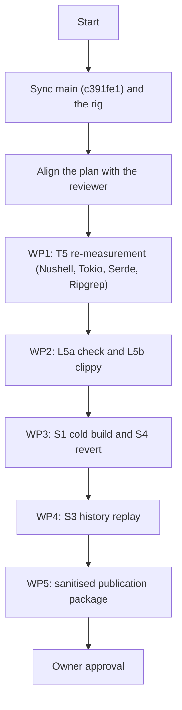

# Mitts Build — Benchmark execution and verification plan (ROADMAP M8)

**Status**: in progress  
**Created**: 2026-10-11  
**Decision owner**: Alexander Panasenko  
**Bench rig**: one Linux x86_64 workstation (16 cores / 32 threads, 186 GB RAM,
Ubuntu 24.04 LTS) with two separate NVMe devices: one formatted XFS with
reflink enabled, one formatted ext4. Host names, mount points and device
models stay in the internal results and never appear in this repository.  
**Binary under test**: a release build of `mitts` from `origin/main` at
`c391fe1` (SHA-256 `189a9b8bb2c99c4b99ad7da38c41c0224705cc0695c60706c90e37b2a846c4d4`).

---

## 1. Goals and standard of proof

This plan takes **ROADMAP M8 (Reproducible benchmark study)** to completion:
reproducible, verified measurements with cryptographic provenance, followed by
a report the project owner can approve for `README.md` and the project site.
Until that approval, no number from this work appears in the README or on the
site.

### Requirements (M8)

1. **Baselines.** Plain `cargo`, `cargo` with a shared target directory, and
   `cargo` with `sccache`. Ratios are reported against `sccache` as the best
   *sound* baseline.
2. **Shared target directory is unsound.** The shared-target arm is kept as a
   demonstration: in the recorded swarms it repeatedly either missed the
   injected test failure or propagated it into clean worktrees. Exact counts
   live in the internal results and are published with them.
3. **Clean environment.** Before every swarm: `sync` and wait until dirty
   memory is below 1 GB. All `cargo` arms run `--offline`. The toolchain
   version is recorded in the provenance of every result (it is recorded, not
   pinned).
4. **Statistics.** Every headline scenario runs as a series of `n = 5` with
   median, IQR, min and max. Single runs are labelled `n = 1`.
5. **Physical I/O.** Bytes written to the device are read from
   `/sys/class/block/<dev>/stat` around each swarm; disk usage is measured with
   `du`. Memory pressure (PSI, dirty and writeback pages) is sampled during
   each swarm.
6. **Provenance.** Every JSON result records the binary SHA-256, the SHA-256
   of every script involved, the git commit, the diagnostic flags and the
   filesystem of the cache and of the worktrees.

---

## 2. Project matrix

| Project | Why it is in the study | Current state | Work packages |
| :--- | :--- | :--- | :--- |
| **Tokio** | Large library plus roughly 260 test binaries (343 units) | L2/L3 accepted at `n = 1`; T5 needs re-measurement | WP1, WP2, WP3 |
| **Serde** | Fast compile, proc-macro derive | T5 at `n = 1`; L5 only on an older binary | WP1, WP2, WP3 |
| **Ripgrep** | Binary plus sub-crates and tests, minimal build scripts | Only older-binary runs | WP1, WP2, WP3, WP4 |
| **Nushell** | Very large project, deep DAG, plugins | Excluded from publication after zero cache hits on an older binary | WP1 first: re-measure before any decision on the exclusion |

---

## 3. Work packages

### WP1. T5 multi-worktree test swarm, re-measured

- **Scenario.** 12 parallel worktrees on 4 different commits of the project
  history. Worktree 12 carries an injected failing test to check soundness.
- **Arms.** `mitts`, `cargo_bare`, `cargo_sccache`, `cargo_shared`.
- **Series.** `n = 5`, rotated arm order, `sync` before every swarm.
- **Filesystems.** XFS with reflink and ext4 with the copy fallback. The two
  filesystems are on different devices; results state this.
- **Order.** Nushell, Tokio, Serde, Ripgrep.
- **Acceptance.** JSON results with full provenance; for `mitts`, `cargo_bare`
  and `cargo_sccache` the injected failure is detected in every run and no
  clean worktree fails; the shared-target arm is expected to violate this and
  is reported as such; a decision on the Nushell exclusion is made from the new
  data.

### WP2. L5a (`check`) and L5b (`clippy`), re-measured

- **Scenario.** Parallel `check` and `clippy` across 12 worktrees on the four
  projects.
- **Script work.** Bring the script up to the T5 standard: `--offline` on the
  cargo arms, device I/O, pressure sampling, provenance.
- **Series.** `n = 5` per project.
- **Acceptance.** JSON results with provenance and diagnostic parity between
  arms.

### WP3. S1 single cold build and S4 branch switch / zero-diff revert

- **S1.** All caches purged and asserted empty before each run. Arms: `mitts`,
  `cargo_bare` with and without incremental compilation, `cargo_sccache`.
  Projects: Tokio, Ripgrep, Serde; `n = 5`.
- **S4.** A worktree switches to the previous commit, builds, and returns to
  `HEAD`. Expected: `mitts` restores the `HEAD` artifacts from the store
  without recompiling; the time is measured, not assumed.
- **Acceptance.** Scripts at the T5 standard and JSON results with medians.

### WP4. S3 git history replay

- **Scenario.** Sequential builds of 5–10 real consecutive commits in one
  directory.
- **Goal.** Show the cumulative effect of the content-addressed store over a
  development timeline.
- **Projects.** Ripgrep first, then Tokio.
- **Acceptance.** Per-step table of build times for every arm.

### WP5. Sanitised data and publication package (M8.4)

- **Sanitising.** A script that strips absolute paths and device identifiers of
  the bench rig from the JSON results and logs.
- **Report.** Static Markdown/HTML tables with medians and spread, generated
  from the JSON only.
- **Owner review.** The package goes to the project owner; the README and the
  site change only after explicit approval.

---

## 4. Order of execution

