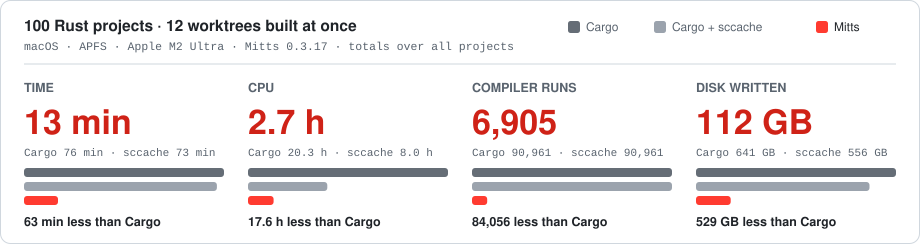
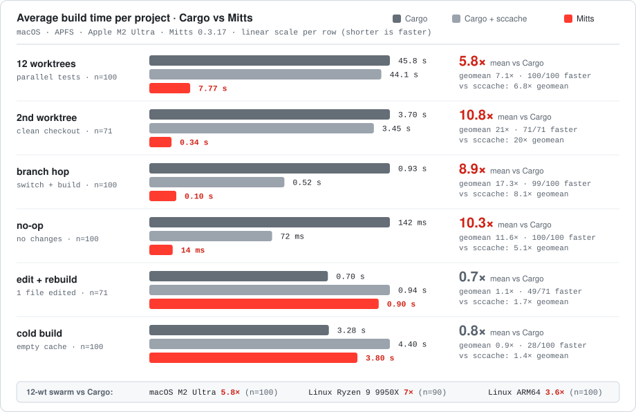
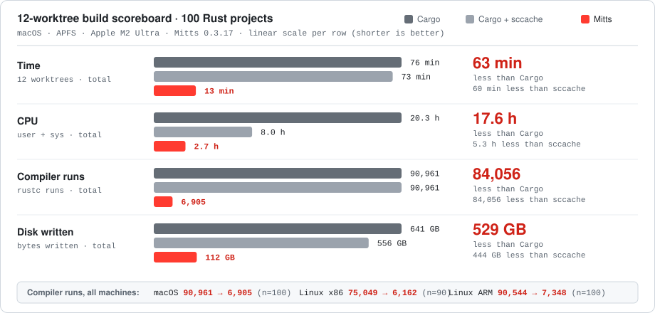

<!-- translation-source: 1a926080b49fae712d44fdae44fb6f96b80d3499 -->

> [!NOTE]
> 이 문서는 커밋 [1a92608](https://github.com/alex09x/mitts/blob/1a926080b49fae712d44fdae44fb6f96b80d3499/README.md) 기준 공식 영문 문서를 번역한 것입니다.
> 기준이 되는 최신 문서는 [영문 README](https://github.com/alex09x/mitts/blob/main/README.md)입니다.

<p align="center">
  
</p>

<h1 align="center">Mitts Build</h1>

<p align="center">
  <b>빌드 작업, 철저하게 계산되다.</b><br>
  머신 전역 콘텐츠 주소 지정 아티팩트 캐시와 명시적 입력 추적을 지원하는 Rust 우선 빌드 시스템.
  기존의 <code>Cargo.toml</code> 및 <code>Cargo.lock</code>을 그대로 읽어 들입니다.
</p>

<p align="center">
  <a href="https://mittsbuild.com"></a>
  
  
  
  
  <a href="https://doi.org/10.5281/zenodo.24030067"></a>
</p>

<p align="center">
  <a href="#quick-start">빠른 시작</a> ·
  <a href="#how-it-works">작동 방식</a> ·
  <a href="#architecture">아키텍처</a> ·
  <a href="../docs/architecture.md">프로토콜</a> ·
  <a href="#limitations">제약 사항</a> ·
  <a href="../ROADMAP.md">로드맵</a>
</p>

<p align="center">
  <a href="https://github.com/alex09x/mitts/blob/main/README.md">English</a> ·
  <a href="https://github.com/alex09x/mitts/blob/main/readme/README.ru.md">Русский</a> ·
  <a href="https://github.com/alex09x/mitts/blob/main/readme/README.zh-CN.md">简体中文</a> ·
  <a href="https://github.com/alex09x/mitts/blob/main/readme/README.es.md">Español</a> ·
  <a href="https://github.com/alex09x/mitts/blob/main/readme/README.pt-BR.md">Português (Brasil)</a> ·
  <a href="https://github.com/alex09x/mitts/blob/main/readme/README.ja.md">日本語</a> ·
  <a href="https://github.com/alex09x/mitts/blob/main/readme/README.de.md">Deutsch</a> ·
  <a href="https://github.com/alex09x/mitts/blob/main/readme/README.fr.md">Français</a> ·
  <b><a href="https://github.com/alex09x/mitts/blob/main/readme/README.ko.md">한국어</a></b> ·
  <a href="https://github.com/alex09x/mitts/blob/main/readme/README.ar.md">العربية</a>
</p>

---

<p align="center">
  <picture>
    <source media="(prefers-color-scheme: dark)" srcset="../docs/img/bench-hero-dark.svg">
    <source media="(prefers-color-scheme: light)" srcset="../docs/img/bench-hero-light.svg">
    
  </picture>
</p>

<p align="center">
  <sub>오픈소스 프로젝트 100개(Linux x86_64는 90개), 각각 12개 워크트리를 세 대의 머신에서 동시에 빌드했습니다. Cargo 및 Cargo + sccache를 기준선으로 삼았으며 Mitts가 더 빠르지 않은 경우도 함께 수록했습니다: <a href="#performance">성능</a> · <a href="https://mittsbuild.com/the-hundred/">The Hundred</a></sub>
</p>

Mitts는 워크스페이스를 직접 계획하고 `rustc`를 직접 호출합니다. 모든 컴파일 액션은 모든 입력 요소로부터 파생된 고유 키를 부여받습니다. 출력물은 머신 전역의 불변 저장소에 단 한 번 저장되며, 프로젝트, 워크트리(worktree), 브랜치에 걸쳐 해당 아티팩트를 필요로 하는 모든 워크스페이스로 복원됩니다.

입력 항목을 완벽하게 파악할 수 없는 경우, 추측하지 않고 해당 액션을 다시 빌드합니다.

## 문제점

Cargo의 빌드 캐시는 각 워크스페이스의 `target/` 디렉터리에 상주합니다. 새로운 `target/`을 생성하는 모든 작업은 0에서부터 다시 시작됩니다:

- 동일한 저장소의 두 번째 체크아웃 또는 `git worktree`,
- `Cargo.lock`을 변경하는 브랜치로 전환했다가 다시 돌아오는 작업,
- 동일한 기능(features)을 가진 동일한 크레이트에 의존하는 다른 프로젝트,
- 각자의 워크트리에서 작업하는 병렬 코딩 에이전트.

동일한 `serde`, `syn` 또는 `tokio`가 반복해서 컴파일되며, 복사본마다 디스크 공간을 낭비합니다.

일반적인 대안들은 치명적인 결함을 내포하고 있습니다:

- **공유 `CARGO_TARGET_DIR`** 은 단일 잠금 뒤에서 빌드를 직렬화하며, 서로 다른 기능 세트를 가진 프로젝트들이 서로의 아티팩트를 덮어씁니다.
- **sccache와 같은 컴파일러 래퍼** 는 한 번에 하나의 `rustc` 호출만 확인합니다. 경로가 정규화되지 않는 한 절대 경로에 의존하며, 링커를 호출하는 크레이트(`bin`, `proc-macro`, `dylib`)는 캐시되지 않습니다. Cargo는 여전히 빌드를 계획하고 모든 빌드 스크립트를 실행합니다.

Mitts는 다른 방식을 취합니다: 컴파일러가 아닌 Cargo의 실행 엔진(executor)을 대체합니다. 전체 유닛 그래프(unit graph)를 파악하므로 종속성의 키를 기반으로 각 유닛의 키를 지정하고, 링킹 유닛과 빌드 스크립트 실행 결과를 캐시하며, 여러 빌드가 하나의 저장소를 안전하게 공유하도록 지원합니다.

## 주요 특징

- **워크스페이스 간 재사용.** 머신당 하나의 공유 저장소. 특정 체크아웃을 위해 컴파일된 종속성은 동일한 입력을 가진 다음 체크아웃에 복원됩니다.
- **완전한 키.** 툴체인, 타깃, 프로필, 플래그, 기능(features), 소스 콘텐츠, 종속성 키 및 추적된 환경 변수. 알 수 없는 입력은 재빌드를 의미합니다.
- **Cargo 매니페스트가 그대로 계약으로 유지됨.** 새로운 매니페스트도, 보조 lockfile도 없습니다. 이 저장소의 빌드, 테스트, 린트, 커버리지 및 릴리스 소스 워크플로는 Mitts를 통해 실행되며, Cargo CLI를 호출하지 않습니다. 외부 사용자를 위한 Cargo 상호 운용성은 계속 제공됩니다.
- **링킹 유닛과 빌드 스크립트 캐시.** `rlib`뿐만 아니라 바이너리, 테스트, 절차적 매크로(proc macro), 빌드 스크립트 실행까지 모두 키를 지정하여 저장합니다.
- **동시 빌드 협력.** 키 단위 잠금: 동일한 종속성을 필요로 하는 두 개의 터미널이나 워크트리는 한 번만 컴파일합니다. 단일 jobserver가 머신의 모든 Mitts 프로세스에 대한 병렬 처리를 조절합니다.
- **안전한 공유.** 저장소 객체는 불변입니다: 원자적으로 게시되고, 읽기 전용으로 저장되며, reflink 또는 복사를 통해 복원됩니다. `MITTS_VERIFY_RESTORE=1`은 복원 전에 모든 객체의 해시를 다시 확인합니다(기본값은 저장소를 신뢰하여 복원되는 바이트마다의 추가 읽기를 방지합니다). 파일시스템이 reflink를 지원하지 않는 경우, 복원 시 바이트를 복사하는 대신 읽기 전용 저장소 객체를 `target/`에 하드링크합니다. 공유 inode는 `0o444`(실행 파일은 `0o555`)를 유지하고, 타깃 인덱스는 쓰기 권한이 부여된 링크를 거부하며, Mitts는 항상 rename을 통해서만 워크스페이스 파일을 교체합니다. 저장소 객체에 대한 쓰기 가능한 링크는 절대 생성되지 않습니다. 다른 도구가 파일 위치에서 직접 수정하는 워크스페이스의 경우 `MITTS_STORE_HARDLINKS=0`을 통해 전용 복사본을 유지할 수 있습니다.
- **제로 카피 워크스페이스 스테이징.** 워크스페이스 내 라이브러리 별칭, 보조 바이너리 및 원자적 유닛 스테이징은 바이트를 복사하지 않고 워크스페이스 내 하드링크 및 rename 승격을 사용합니다. `MITTS_CACHE_DIR`과 워크스페이스 `target/`이 동일한 파일시스템 볼륨에 상주할 때 스테이징 승격은 바이트 복사 없이 작동하며, 서로 다른 마운트에 걸쳐 있을 경우 투명하게 안전한 복사로 폴백합니다.
- **No-op 빠른 경로.** 변경되지 않은 워크스페이스는 계획 수립 및 키 지정을 건너뜁니다.
- **단일 CLI.** `build`, `run`, `check`, `clippy`, `fmt`, `test`(doctest 포함), `coverage`, `explain`, `fetch`, `gc`, `clean`.

<a id="quick-start"></a>
## 빠른 시작

서명된 최신 네이티브 릴리스 설치:

```sh
curl -fsSL https://mittsbuild.com/install.sh | sh
```

소스 체크아웃을 빌드하려면 먼저 최신 릴리스된 Mitts를 설치한 후, Mitts를 사용하여 체크아웃을 빌드하십시오:

```sh
git clone https://github.com/alex09x/mitts
cd mitts
mitts build --release
MITTS_JOBS=2 mitts build     # limit concurrent native build units
install -m755 target/release/mitts "$HOME/.cargo/bin/mitts"
```

그런 다음 아무 Cargo 워크스페이스 내부에서 실행하십시오:

```sh
mitts build                  # compile into target/debug/
mitts build --release
mitts run                    # build and run a binary
mitts test                   # unit, integration and doc tests
mitts test --tests -p foo    # Cargo-style target selection
mitts test -c                # every test in its own process, all the cores (-c=8: 8): docs/test-concurrency.md
mitts test --all-targets --no-run  # compile tests, examples and benchmarks
mitts bench                  # build benchmark targets (bench profile) and run them with --bench
mitts bench --bench speed -- --save-baseline main
# The cache stays under MITTS_CACHE_MAX_BYTES (default 100G) by itself: docs/cache-limits.md
mitts llvm-cov --ignore-filename-regex 'tests/' --fail-under-lines 80
mitts check | clippy | fmt | coverage
mitts explain                # the plan, units and why each is cached or not
mitts fetch                  # prefetch dependencies into the source store
mitts package                # create and verify a source archive
mitts publish --dry-run      # prepare publication without uploading
mitts gc                     # prune the shared store within quotas
mitts clean                  # remove this workspace's Mitts artifacts
```

Git 프로젝트의 경우, 패키징에는 현재 패키지가 루트에 위치한 깨끗한 상태의 저장소가 필요합니다. 매니페스트 `include` 패턴으로 무시된 파일을 선택할 수 있으며, 중첩된 워크스페이스 패키지 및 심볼릭 링크 디렉터리는 아직 지원되지 않습니다. `mitts publish`는 crates.io를 대상으로 하며 `CARGO_REGISTRY_TOKEN`에서 토큰을 읽습니다.

Mitts는 빌드 출력물을 Cargo의 일반적인 `target/debug/` 및 `target/release/` 디렉터리에 작성합니다. `CARGO_TARGET_DIR` 및 `--target-dir`을 통해 다른 출력 루트를 선택할 수 있습니다. 공유 캐시는 별도로 분리되어 있습니다(`--cache-dir`, 미지정 시 `$MITTS_CACHE_DIR`, `$XDG_CACHE_HOME/mitts`, 또는 `~/.cache/mitts`). 아티팩트 저장소, 액션 캐시, 잠금, jobserver, 소스 저장소, git 미러 및 인덱스 캐시가 모두 이 단일 루트 아래에 상주합니다.

공개 또는 비공개 Git 종속성은 Mitts가 시스템 `git`을 사용하여 직접 클론하므로 SSH 키, 에이전트, 자격 증명 헬퍼 및 `GIT_SSH_COMMAND`가 명령줄에서와 똑같이 적용됩니다. 프롬프트 입력은 비활성화되어 있으므로 자격 증명이 누락되면 멈추는 대신 오류로 종료됩니다. Cargo를 거치지 않습니다. Cargo가 `~/.cargo/git/checkouts`에 이미 생성한 체크아웃은 다시 클론하지 않고 재사용합니다.

Cargo가 크레이트를 가져오는 다른 모든 방식도 동일한 설정에서 똑같이 작동합니다:

- **대체 레지스트리**: `[registries.<name>] index = "sparse+https://…"` 및 종속성의 `registry = "<name>"`. 토큰은 Cargo 자격 증명 공급자로부터 Cargo의 순서대로 가져옵니다: `cargo:token`(환경 변수 및 `credentials.toml`), `cargo:macos-keychain`, `cargo:libsecret`, `cargo:token-from-stdout <command>`, 그리고 `[registry] global-credential-providers`, `[registries.<name>] credential-provider`, `[credential-alias]`로 구성된 자격 증명 공급자 프로토콜을 통하는 `cargo-credential-1password`와 같은 플러그인. `config.json`에 `auth-required`가 명시된 레지스트리는 토큰을 가진 공급자가 없을 때 명확한 메시지와 함께 실패합니다. Git 인덱스 레지스트리는 거부되므로 sparse 프로토콜을 사용하십시오.
- **미러**: `[source.crates-io] replace-with = "<name>"` 및 `[source.<name>] registry = "sparse+https://…"`. 바이트는 미러에서 가져오고, `Cargo.lock`에는 Cargo가 작성한 것과 똑같이 crates.io 이름이 유지됩니다.
- **벤더링된 소스**: `cargo vendor`에서 생성된 `[source.vendored-sources] directory = "vendor"`. 패키지는 `.cargo-checksum.json`에 대해 검증된 후 저장소에 복사됩니다. git 패키지를 포함하여 네트워크를 전혀 사용하지 않습니다. lockfile이 없으면 vendor 디렉터리가 인덱스 역할을 합니다.
- **`[patch]`**: `[patch.crates-io] foo = { path = … }` 또는 `{ git = … }`는 레지스트리 패키지를 대체합니다. lockfile이 없으면 대체 항목이 확인 및 고정되며, Cargo와 마찬가지로 요구 사항을 충족해야 합니다.

Cargo 설정의 `[env]`는 rustc, 빌드 스크립트, 그리고 `mitts run` 및 `mitts test`가 시작하는 프로그램에 Cargo의 `force` 및 `relative` 규칙과 함께 적용됩니다. 설정 파일 자체가 입력 항목이므로, 값이 변경되면 이를 읽은 항목이 다시 빌드됩니다.

`Cargo.lock`이 없는 경우, Mitts는 Cargo와 동일한 방식으로 의존성을 해석합니다: 요구 사항당 제외(yank)되지 않은 가장 높은 버전 선택, 에지를 따라 흐르는 기능 플래그, 기능이 활성화할 때만 포함되는 선택적 종속성, 호환성 범위당 하나의 버전. 그 결과 Cargo가 자체 생성한 것으로 인식하는 lockfile이 생성됩니다.

<a id="how-it-works"></a>
## 작동 방식

```
Cargo.toml + Cargo.lock
        │
        ▼
 resolve ─── reuse Cargo.lock, or resolve against the crates.io sparse index
        │
        ▼
 fetch ───── download .crate archives in parallel, verify, unpack once per machine;
        │    clone git dependencies with the system git at the locked commit
        │
        ▼
 plan ────── compilation units: lib · bin · test · build script · proc macro
        │    with features, targets and dependency edges (Cargo's resolver rules)
        ▼
 key ─────── SHA-256 over toolchain, target, profile, flags, features,
        │    source contents, dependency keys and tracked environment
        ▼
 execute ─── parallel DAG of direct rustc calls, pipelined on .rmeta
             hit  → restore from the store (reflink, read-only link or copy)
             miss → lock the key, compile, publish atomically to the store
```

유닛의 키에는 출력 바이트가 아닌 종속성의 **키**가 포함되므로, 유닛 하위의 어떤 변경 사항이든 해당 유닛의 키를 변경합니다. 빌드 스크립트는 스테이징 디렉터리에서 실행됩니다. 빌드 스크립트의 지시문(`rustc-cfg`, `rustc-link-*`, `rustc-env`, …)은 스크립트가 구성하는 유닛의 키에 반영되며, `rerun-if-*` 선언은 캐시된 실행을 언제 재사용할 수 있는지 결정합니다.

빌드가 성공하면 Mitts는 워크스페이스의 스냅샷을 기록합니다. 변경된 부분이 없다면 다음 빌드는 결과로 바로 건너뜁니다. 불일치가 발생하면 전체 키 기반 빌드로 폴백하므로, 빠른 경로가 프로토콜이 수행해야 할 작업을 건너뛰는 일은 절대 없습니다.

전체 프로토콜(키 파생, 잠금, 빌드 스크립트, 빠른 경로, 저장소 레이아웃 및 가비지 컬렉션)은 [docs/architecture.md](../docs/architecture.md)에 나와 있습니다.

<a id="architecture"></a>
## 아키텍처

Mitts는 언어 중립적인 코어 위에 언어 어댑터가 얹힌 구조입니다. 코어는 Cargo에 대해 전혀 알지 못하며, Rust 어댑터가 Cargo 워크스페이스를 키가 지정된 액션으로 변환합니다.

```
                 ┌──────────────────────────────────────────────┐
  mitts CLI ───▶ │ Rust adapter                                 │
  (src/cli)      │ manifest · resolver · fetcher · features     │
                 │ planner · keys · DAG runner · build scripts  │
                 ├──────────────────────────────────────────────┤
                 │ C/C++ adapter (experimental, Mitts.toml)     │
                 └──────────────────────┬───────────────────────┘
                                        │ actions + keys
                 ┌──────────────────────▼───────────────────────┐
                 │ Core                                         │
                 │ content-addressed store · action cache       │
                 │ key locks · jobserver · fast path · GC       │
                 └──────────────────────────────────────────────┘
```

| 경로 | 구성 내용 |
| --- | --- |
| `src/cli/` | 명령 핸들러: `build`, `test`, `clippy`, `explain`, … |
| `src/adapter/rust/` | Cargo 시맨틱: 매니페스트, lockfile, sparse 인덱스, 기능 해석, 유닛 계획, 액션 키, DAG 러너, 빌드 스크립트, doctest |
| `src/adapter/c/` | 동일한 저장소 기반의 실험적 C/C++ 어댑터 |
| `src/core/` | 언어 중립적 저장소(`cas.rs`), 액션 캐시, 잠금, jobserver, 빠른 경로(`build_lock*.rs`), GC, reflink |
| `docs/` | [프로토콜](../docs/architecture.md), [설계 결정 사항](../docs/decisions), [시나리오](../docs/scenarios) |
| `tests/` | 통합 테스트(Cargo 동등성 및 캐시 무효화 테스트 포함) |
| `scripts/` | 벤치마크 및 감사 하네스 |
| `fixtures/` | 테스트에 사용되는 최소한의 Rust 및 C 프로젝트 |

## 캐시를 무효화하는 요인

캐시 히트가 발생하려면 아래의 모든 입력이 일치해야 합니다. Mitts가 입력을 확인할 수 없는 경우 결과를 재사용하지 않습니다.

| 입력 항목 | 추적 방식 |
| --- | --- |
| 툴체인 | `rustc -vV` 출력 |
| 타깃 및 프로필 | 타깃 트리플, 프로필 설정, `RUSTFLAGS` 및 Cargo 설정의 rustflags |
| 기능(Features) | 유닛의 해석된 기능 세트 (Cargo와 동일하게 resolver 1 또는 2) |
| 소스 | 패키지 파일과 rustc가 읽었다고 보고한 모든 파일의 콘텐츠 해시 (`include_str!`, `include_bytes!`, 모듈) |
| 종속성 | 모든 종속성 유닛의 액션 키 |
| 환경 변수 | 관련된 `CARGO_*` 및 `RUST_*` 설정, 그리고 `env!` / `option_env!`를 통해 읽은 변수 (`<unset>` 명시적 기록 포함) |
| Cargo 설정 | Cargo가 읽는 `.cargo/config(.toml)` 파일들 |
| 빌드 스크립트 | 지시문, `OUT_DIR`, 그리고 `rerun-if-changed` 경로의 콘텐츠 및 `rerun-if-env-changed` 변수 값 |

구성된 `rustc-wrapper` 및 `rustc-workspace-wrapper` 프로그램은 컴파일을 위해 호출됩니다. 임의의 래퍼가 추적되지 않는 입력에 의존할 수 있으므로, 두 래퍼 중 하나라도 활성화되어 있으면 Mitts는 액션 캐시 및 빌드 스크립트 캐시 재사용을 비활성화합니다. 이로 인해 빌드가 느려질 수 있습니다.

일부 절차적 매크로는 확장되는 동안 패키지의 파일을 읽습니다: `sqlx`는 `.sqlx/`에 대해 쿼리를 확인하고, `askama`는 `templates/`를 컴파일하며, `rust-embed`와 `include_dir`은 전체 디렉터리를 포함합니다. rustc는 매크로가 이를 등록할 때만 해당 읽기를 인지하므로, 루트 `Cargo.toml`에 이러한 크레이트를 선언하십시오:

```toml
[workspace.metadata.mitts]          # [package.metadata.mitts] in a single crate
impure-proc-macros = ["sqlx", "askama", "rust-embed"]
```

나열된 매크로에 의존하는 크레이트는 패키지의 모든 파일과 절대 경로를 기반으로 키가 지정됩니다. 템플릿이 편집되면 다시 빌드되며, 다른 체크아웃에서는 절대 재사용되지 않습니다. 다른 모든 매크로는 순수한 것으로 간주되며, 이에 의존하는 항목은 워크트리 간에 공유됩니다. 의존하는 크레이트 이름을 지정하십시오. 해당 크레이트가 끌어오는 매크로 크레이트(`sqlx-macros`)도 동작합니다.

## 비교

각 도구가 작업을 재사용하는 방식에 대한 정성적 비교입니다. 성능에 대한 주장이 아닙니다.

| | Cargo | Cargo + sccache | Mitts |
| --- | --- | --- | --- |
| `Cargo.toml` / `Cargo.lock`을 있는 그대로 읽음 | 예 | 예 | 예 |
| 워크스페이스 및 워크트리 간 재사용 | 아니요 (`target/`별) | 예, `rustc` 호출별 | 예, 유닛별 |
| 키가 체크아웃 경로에 의존함 | — | 예, 정규화되지 않은 경우 | 레지스트리 크레이트는 아니요; 워크스페이스 크레이트는 대상이 아닐 때만 |
| `bin`, 테스트 및 `proc-macro` 유닛 캐시 | — | 아니요 | 예 |
| 빌드 스크립트 실행 캐시 | 아니요 | 아니요 | 예 |
| 단일 종속성의 동시 빌드 | `target/` 잠금에서 대기 | 미스 발생 시 둘 다 컴파일할 수 있음 | 하나는 컴파일하고, 다른 하나는 재사용 |
| 원격 / 팀 캐시 | 아니요 | 예 (S3, GCS, Redis, …) | 계획됨 |
| Windows | 예 | 예 | 아니요 |

Bazel과 Buck2는 더 큰 문제(원격 실행을 지원하는 밀폐형 다중 언어 빌드)를 해결하지만 `Cargo.toml` 대신 자체 빌드 파일이 필요합니다.

<a id="limitations"></a>
## 제약 사항

Mitts는 프리릴리스 단계입니다. 이에 의존하기 전에 다음 사항을 확인하십시오:

- **Linux 및 macOS 전용.** 잠금 및 jobserver가 POSIX 기반입니다.
- **호스트 타깃 전용.** 크로스 컴파일은 아직 지원되지 않습니다.
- **원격 캐시 아직 미지원.** 저장소는 머신별로 로컬입니다.
- **Sparse 레지스트리 전용.** git 인덱스로 제공되는 레지스트리(crates.io 이외의 `registry+…`, 또는 `sparse+`가 없는 `[source] registry = "https://…"`) 및 `local-registry` 소스는 안내 메시지와 함께 거부됩니다.
- **자격 증명은 읽기 전용이며 쓰지 않음.** `cargo login`은 Cargo의 역할로 유지됩니다. `cargo:wincred`는 Windows 전용이므로 건너뜁니다.
- **일부 유닛은 절대 캐시되지 않음:** `cdylib`, `dylib` 또는 `staticlib` 타입의 크레이트 및 `env!` 읽기를 추적할 수 없는 크레이트. 이들은 항상 빌드되며, `mitts explain`에 의해 보고됩니다.
- **체크아웃 간 워크스페이스 크레이트.** 자체 크레이트는 키를 경로 독립적으로 만들 수 있는 경우에만 워크트리 간에 재사용됩니다(`CARGO_MANIFEST_DIR` 읽기 없음, 빌드 스크립트 없음, 선언된 impure 절차적 매크로 없음). 그렇지 않으면 키에 절대 경로가 포함됩니다. macOS에서는 링커의 디버그 stab이 워크스페이스에 상대적으로 작성되므로(`-oso_prefix`), 링크된 바이너리도 공유됩니다. 디버거가 오브젝트 파일을 찾을 수 있도록 워크스페이스 루트에서 디버거를 시작하십시오.
- **파일을 읽는 매크로는 직접 선언해야 함.** 프로젝트에서 목록에 명시하지 않는 한 절차적 매크로는 순수한 것으로 취급됩니다(위 내용 참조). 목록에 명시된 매크로의 종속 항목은 패키지의 모든 파일을 따릅니다. rustc에 등록하지 않고 파일을 읽는 목록 외 매크로는 Cargo와 마찬가지로 오래된 결과를 초래할 수 있습니다.
- **빌드 스크립트는 샌드박스화되지 않음.** `rerun-if-*`로 선언하지 않은 파일이나 변수를 읽는 스크립트는 Cargo와 마찬가지로 오래된 결과를 초래할 수 있습니다.
- **지원되지 않는 Cargo 기능은 명확히 오류 발생.** 예를 들어 `--profile`이나 `workspace.members`의 중간 디렉터리에 와일드카드가 있는 glob 등. Mitts는 추측하지 않고 명확하게 보고합니다.
- **동일 파일시스템 제로 카피.** 스테이징에서의 제로 카피 유닛 승격은 `MITTS_CACHE_DIR`과 워크스페이스의 `target/` 디렉터리가 동일한 파일시스템 마운트에 상주해야 합니다. 파일시스템 경계를 넘는 경우 안전하게 표준 복사로 폴백합니다.

Windows, 크로스 컴파일, 팀 캐시 또는 안정적인 릴리스가 필요한 경우 **아직 Mitts를 사용하지 마십시오**. 그러한 환경에서는 Cargo(필요 시 sccache 병용)가 안전한 선택입니다.

<a id="performance"></a>
## 성능

Mitts `0.3.17`을 사용하여 macOS(Apple M2 Ultra, APFS) 및 Linux ARM64(XFS)의 **오픈소스 Rust 프로젝트 100개**, Linux x86_64(AMD Ryzen 9 9950X, XFS)의 **90개 프로젝트**를 대상으로 일반 `cargo` 및 `cargo` + `sccache`(`0.17.0`)와 비교 측정했습니다. 모든 수치는 진단 메시지, 종료 코드, 테스트 결과 동등성을 검증한 3회 반복 측정의 중앙값이며, 측정된 모든 프로젝트가 합계에 포함되고(노이즈로 표시된 `0`, `7`, `0`건 포함) 어떤 수치도 측정치를 부풀리지 않도록 기준선은 버림하고 Mitts는 올림 처리했습니다([ROADMAP M8](../ROADMAP.md)). 전체 연구 결과, 개별 프로젝트 데이터 및 방법론은 [mittsbuild.com/the-hundred](https://mittsbuild.com/the-hundred/)에 공개되어 있습니다.

<p align="center">
  <picture>
    <source media="(prefers-color-scheme: dark)" srcset="../docs/img/bench-scenarios-dark.svg">
    <source media="(prefers-color-scheme: light)" srcset="../docs/img/bench-scenarios-light.svg">
    
  </picture>
</p>

각 행은 중앙값 프로젝트의 빌드 시간(프로젝트 전체에 대한 각 도구 자체의 중앙값, 행별 선형 스케일)을 나타내며, 그 옆에 Mitts가 가장 먼저 완료된 프로젝트 수를 표시합니다. macOS에서 중앙값 프로젝트가 12개 워크트리를 빌드하는 데 `cargo`는 **32 s**, `cargo` + `sccache`는 **31 s**, Mitts는 **3.8 s**가 걸립니다. 로컬 저장소가 예열된 상태에서 두 번째 클린 워크트리는 각각 **1.7 s**, **1.6 s**, **79 ms**, 브랜치 전환은 **627 ms**, **209 ms**, **27 ms**, 변경 사항 없는 재빌드는 **100 ms**, **41 ms**, **9 ms**가 소요됩니다. 이 네 가지 시나리오에서 Mitts는 100개 프로젝트 중 99–100개에서 가장 먼저 완료됩니다(두 번째 워크트리는 71개 중 71개).

Mitts가 앞지르지 못하는 경우:

- **콜드 빌드, 빈 캐시.** Mitts는 입력을 해시하고 빈 저장소를 채워야 하므로 일반 `cargo`가 macOS 100개 프로젝트 중 71개(Linux x86_64는 90개 중 60개, Linux aarch64는 100개 중 77개)에서 먼저 완료되며, 가장 큰 프로젝트에서는 최대 6.2 s까지 앞섭니다. 중앙값 프로젝트는 `cargo`가 **1.7 s**, Mitts가 **2.0 s**입니다. 콜드 상태의 `sccache`(**2.4 s**, 100개 중 86개에서 Mitts 우세)보다는 Mitts가 앞섭니다.
- **파일 하나 수정.** 중앙값 프로젝트는 `cargo` **364 ms**, `sccache` **596 ms**, Mitts **315 ms**이며, `cargo` 대비 71개 프로젝트 중 49개에서 Mitts가 먼저 완료됩니다. 나머지 22개(x86_64는 64개 중 21개, aarch64는 71개 중 29개)에서는 `cargo`가 macOS 기준 최대 2.6 s, x86_64 기준 최대 8.6 s 먼저 완료되는데, 대형 크레이트 내부에서 `rustc` 증분 컴파일을 재사용하는 반면 Mitts는 전체 크레이트 단위로 캐싱하기 때문입니다.
- **10개 커밋 연속 재생**(차트 미포함): 우열이 나뉘며 macOS 100개 프로젝트 중 58개에서 Mitts가 먼저 완료되고 중앙값도 비슷합니다(`cargo` **5.6 s**, Mitts **5.8 s**).

<p align="center">
  <picture>
    <source media="(prefers-color-scheme: dark)" srcset="../docs/img/bench-swarm-dark.svg">
    <source media="(prefers-color-scheme: light)" srcset="../docs/img/bench-swarm-light.svg">
    
  </picture>
</p>

전체 프로젝트에서 4개 커밋에 걸친 **12개 병렬 워크트리** 빌드, 머신별 합계:

| 머신 | 시간: `cargo` / `sccache` / Mitts | `rustc` 실행 횟수: `cargo` / Mitts | 디스크 쓰기 용량: `cargo` / Mitts |
|---|---|---|---|
| macOS, APFS, M2 Ultra (100개 프로젝트) | 76 min / 73 min / **13 min** | 90,961 / **6,905** | 641 GB / **112 GB** |
| Linux x86_64, XFS, Ryzen 9 9950X (90개 프로젝트) | 60 min / 52 min / **9 min** | 75,049 / **6,162** | 651 GB / **106 GB** |
| Linux aarch64, XFS (100개 프로젝트) | 78 min / 76 min / **22 min** | 90,544 / **7,348** | 743 GB / **121 GB** |

macOS의 CPU 시간은 **20.3 h**(`cargo`) 및 **8.0 h**(`sccache`)에서 **2.7 h**로 줄어듭니다. x86_64 머신에서는 100개가 아닌 90개 프로젝트가 측정되었습니다. 해당 실행에서 10개 프로젝트(similar, smallvec, smol, syntect, tealdeer, tera, textwrap, tokei, tower-http, xh)가 누락되었으며 원인은 기록되어 있지 않습니다.


## 진행 현황

| 영역 | 상태 |
| --- | --- |
| `Cargo.toml` / `Cargo.lock` 판독, sparse 인덱스 해석 | 완료 |
| 기능(Feature) 해석 (resolver 1 및 2) | 완료 |
| 병렬 다운로더 및 글로벌 소스 저장소 | 완료 |
| 네이티브 DAG 러너, 파이프라인 `rustc`, jobserver | 완료 |
| 콘텐츠 주소 지정 저장소 및 액션 캐시 | 완료 |
| 빌드 스크립트 실행 및 캐싱 | 완료 |
| No-op 빠른 경로 | 완료 |
| `check`, `clippy`, `fmt`, `test`(doctest 포함), `coverage` | 완료 |
| 쿼터 기반 보수적 GC | 완료 |
| 동일 저장소 기반 C/C++ 어댑터 | 실험적 |
| 워크스페이스 크레이트의 경로 독립적 키 | 부분 지원 |
| 재현 가능한 벤치마크 연구 | 완료 |
| 원격 / 팀 캐시 | 계획됨 |
| Windows, 크로스 컴파일 | 지원 안 됨 |

마일스톤 및 근거 자료: [ROADMAP.md](../ROADMAP.md).

## 자주 묻는 질문 (FAQ)

**Mitts가 Cargo를 대체합니까?**
Mitts는 기존 Cargo 매니페스트와 lockfile을 읽고 이 프로젝트에 Rust 빌드/테스트 워크플로를 제공합니다. 자체 CI 및 릴리스 워크플로는 Cargo를 호출하지 않고 Mitts를 사용합니다. 외부 사용자를 위해 Cargo도 계속 지원됩니다.

**CI에서 사용할 수 있습니까?**
예. 이 저장소의 CI는 안정적인 최신 버전의 Mitts를 설치한 후 네이티브 빌드, 테스트, 커버리지, 포맷팅 및 Clippy에 이를 사용합니다. 공유 아티팩트 저장소는 각 러너의 로컬에 유지되며, 머신 간 원격 캐시는 아직 지원되지 않습니다.

**rust-analyzer나 기존 Cargo 출력과 충돌합니까?**
Mitts는 Cargo와 동일한 기본 출력 경로를 사용합니다. 공유 아티팩트 저장소는 별도로 분리되어 있으며, `mitts clean`은 기록된 콘텐츠와 여전히 일치하는 색인된 Mitts 출력물만 제거하고 관련이 없거나 대체된 Cargo 파일은 보존합니다. Cargo가 특정 프로필의 빌드 디렉터리 잠금을 보유하고 있는 경우, 해당 빌드가 완료될 때까지 정리가 건너뛰어집니다.

**캐시는 어디에 있으며 어떻게 삭제합니까?**
`--cache-dir`, 미지정 시 `$MITTS_CACHE_DIR`, `$XDG_CACHE_HOME/mitts` 또는 `~/.cache/mitts`. Mitts가 캐시하는 모든 항목은 이 단일 루트 아래에 상주합니다. 할당량 내에서 정리하려면 `mitts gc`를 실행하십시오. 실행 중인 빌드가 없을 때는 디렉터리를 직접 삭제해도 안전합니다.

**특정 유닛이 캐시되지 않은 이유는 무엇입니까?**
`mitts explain`을 실행하십시오. 모든 유닛과 해당 유닛이 캐시 대상인지 아닌지에 대한 이유가 나열됩니다.

## 설계 원칙

- 빌드 및 캐시 오케스트레이션은 언어 중립을 유지합니다. 언어별 시맨틱은 어댑터에 상주하며, Rust가 첫 번째입니다.
- 캐시 히트는 완전하고 추적된 입력을 필요로 합니다. 알려지지 않은 입력은 변경된 것으로 처리됩니다.
- 공유 아티팩트는 불변이며 사용 전 검증됩니다. 가변 상태는 각 워크스페이스 내에 유지됩니다. 쓰기 가능한 파일에 대한 하드링크나 타임스탬프 조작은 금지됩니다.
- 정리 작업은 활성 상태의 빌드 아티팩트를 절대 건드리지 않습니다.

기여자 및 에이전트 규칙: [AGENTS.md](../AGENTS.md).
아키텍처 결정 사항: [docs/decisions](../docs/decisions).

## 작성자

[Alexander Panasenko](https://prod.codes/about/) · alex@prod.codes ·
[mittsbuild.com](https://mittsbuild.com)

## 인용

Mitts를 인용하려면 보관된(archived) 릴리스를 사용하세요. 개념 DOI [10.5281/zenodo.24030067](https://doi.org/10.5281/zenodo.24030067)는 항상 최신 버전을 가리키며, 0.3.32 버전의 DOI는 [10.5281/zenodo.24100051](https://doi.org/10.5281/zenodo.24100051)입니다. GitHub의 “Cite this repository”는 [CITATION.cff](../CITATION.cff)를 읽습니다.

```bibtex
@software{panasenko_2026_24100051,
  author    = {Panasenko, Alexander},
  title     = {Mitts Build — Rust-first build system with a machine-wide, content-addressed artifact cache},
  year      = {2026},
  publisher = {Zenodo},
  version   = {0.3.32},
  doi       = {10.5281/zenodo.24100051},
  url       = {https://doi.org/10.5281/zenodo.24100051}
}
```

## 라이선스

선택에 따라 [MIT](../LICENSE-MIT) 또는 [Apache-2.0](../LICENSE-APACHE)의 이중 라이선스가 적용됩니다.
